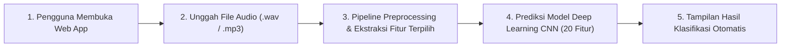

# Wireframe & Alur Sistem Klasifikasi Audio (Human vs AI)

Dokumen ini disusun sesuai dengan **Ketentuan Evaluasi Proyek Sains Data - Pertemuan ke-10 (PROMT.md)**.

---

## 1. Konsep & Batasan Sistem

Sistem ini dikembangkan untuk mendeteksi keaslian suara (**Human Voice** vs **AI Generated Voice**) berbasis rekaman file audio digital.

> **Catatan Penting Batasan Sistem:**
> - Proyek ini **BUKAN** sistem *audio streaming* atau penyadapan panggilan telepon langsung secara *real-time*.
> - Alur kerja sistem adalah sistem inferensi berkas (*file-based audio classification*), di mana pengguna mengunggah atau memasukkan berkas audio, sistem memprosesnya di latar belakang, dan langsung menyajikan hasil diagnosis klasifikasi kepada pengguna.

---

## 2. Alur Penggunaan Sistem (End-to-End Workflow)



1. **Pengguna Membuka Aplikasi:** Pengguna mengakses antarmuka berbasis web Flask di browser (`http://127.0.0.1:5000/`).
2. **Pengguna Mengunggah Berkas Audio:** Pengguna memilih atau mengunggah berkas rekaman suara (format WAV/MP3 durasi 5–30 detik) atau memilih sampel audio yang telah disediakan.
3. **Sistem Melakukan Preprocessing & Ekstraksi Fitur (Di Belakang Layar):**
   - Normalisasi amplitudo dan konversi frekuensi sampling ke **16.000 Hz Mono**.
   - Segmentasi audio per jendela waktu **5 detik**.
   - Ekstraksi fitur akustik dan pemfilteran otomatis ke **20 Fitur Terbaik** hasil seleksi fitur.
   - Transformasi skala menggunakan `StandardScaler`.
4. **Sistem Menjalankan Inferensi Model:** Matriks fitur diproses oleh model **Deep Learning 1D-CNN (*Convolutional Neural Network*)** yang telah dilatih menggunakan dataset `file_seleksi_fitur.csv`.
5. **Sistem Menampilkan Hasil Klasifikasi:** Website langsung menyajikan status keaslian suara:
   - **Human Voice** (*Suara terindikasi manusia asli*)
   - **AI Generated Voice** (*Suara terindikasi hasil generasi/manipulasi AI*)
   - Disertai visualisasi Mel-Spektrogram dan probabilitas keyakinan (*confidence score*).

---

## 3. Diagram Wireframe Antarmuka (UI Layout Mockup)

```text
+--------------------------------------------------------------------------------------------------+
|  [Voice Authenticity Detector]                                  Status: Ready (20 Selected Feat) |
+--------------------------------------------------------------------------------------------------+
|                                                                                                  |
|  +---------------------------------+  +---------------------------------+  +------------------+  |
|  | PANEL 1: UPLOAD FILE AUDIO      |  | PANEL 2: REKAM MIKROFON         |  | PANEL 3: SAMPEL  |  |
|  |---------------------------------|  |---------------------------------|  |------------------|  |
|  | [ Drag & Drop File .wav / .mp3] |  | [ Record ]  [ Stop & Analisis ] |  | Dropdown:        |  |
|  | [ Pilih Berkas dari Komputer ]  |  | Durasi: 00:05.0s                |  | [audio_001.wav v]|  |
|  | Audio Player Preview: [ > ====] |  | Audio Player Preview: [ > ====] |  | [ Uji Sampel ]   |  |
|  |                                 |  |                                 |  |                  |  |
|  | [ Tombol: Analisis File Audio ] |  |                                 |  |                  |  |
|  +---------------------------------+  +---------------------------------+  +------------------+  |
|                                                                                                  |
|  +--------------------------------------------------------------------------------------------+  |
|  | HASIL DETEKSI LANGSUNG (DEEP LEARNING CNN):                                                |  |
|  |                                                                                            |  |
|  |   [ BADGE STATUS: HUMAN VOICE / AI GENERATED VOICE ]     Confidence Score: 100.0%          |  |
|  |   Informasi Berkas: audio_sample.wav | Durasi: 15.0s | Inferensi Langsung Model CNN         |  |
|  |                                                                                            |  |
|  |   Probabilitas Manusia Asli: [=========================] 100.0%                            |  |
|  |   Probabilitas Manipulasi AI: [                         ] 0.0%                             |  |
|  |                                                                                            |  |
|  |   [ Visualisasi: Waveform & Mel-Spectrogram Audio ]                                        |  |
|  |   +------------------------------------------------------------------------------------+   |  |
|  |   | [ Waveform Amplitudo Sinyal ]          | [ Mel-Spectrogram Frekuensi Audio ]       |   |  |
|  |   +------------------------------------------------------------------------------------+   |  |
|  |                                                                                            |  |
|  |   [ Tabel Komparasi Nilai Fitur Akustik Terpenting vs Referensi ]                          |  |
|  +--------------------------------------------------------------------------------------------+  |
+--------------------------------------------------------------------------------------------------+
```

---

## 4. Ilustrasi Wireframe Grafis

Gambar visual wireframe resolusi tinggi tersimpan pada:
`uas/AudioClasification/web-statis-voice-detection/images/wireframe_sistem_klasifikasi.png`

